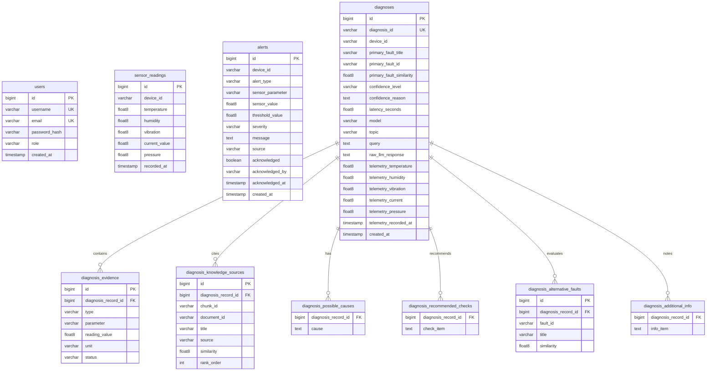

# P_311 — Database Schema & Data Dictionary

This document details the relational database architecture, table definitions, constraints, indexes, and entity relationships implemented in **PostgreSQL 18.6** (compatible with 16+) for the `iot_fault_diagnosis` database.

---

## 1. Relational Entity-Relationship Diagram

---

## 2. Table Specifications

### 2.1 `sensor_readings`
Stores continuous time-series telemetry received from edge devices via MQTT.
- `id` (bigint, PK, auto-increment): Primary key.
- `device_id` (varchar(255), NOT NULL): Unique asset identifier (e.g., `ESP32_001`).
- `temperature` (double precision): Ambient / casing temperature (°C).
- `humidity` (double precision): Relative humidity (%).
- `vibration` (double precision): Overall mechanical vibration velocity (mm/s).
- `current_value` (double precision): Operating phase current (A).
- `pressure` (double precision): Pneumatic line pressure (bar).
- `recorded_at` (timestamp without time zone, DEFAULT CURRENT_TIMESTAMP): Reading timestamp.

### 2.2 `diagnoses`
Core entity for persisted AI diagnostic assessments.
- `id` (bigint, PK, auto-increment): Surrogate primary key.
- `diagnosis_id` (varchar(255), UNIQUE, NOT NULL): Business identifier (`diag-{deviceId}-{timestamp}`).
- `device_id` (varchar(255), NOT NULL): Target asset identifier.
- `primary_fault_title` (varchar(255)): Name of the primary identified fault.
- `primary_fault_id` (varchar(50)): Coded fault identifier (e.g., `FAULT-001`).
- `primary_fault_similarity` (double precision): Vector similarity score to knowledge chunk.
- `confidence_level` (varchar(20)): `high`, `medium`, or `low`.
- `confidence_reason` (text): Explanation of confidence determination.
- `latency_seconds` (double precision): Total inference duration.
- `model` (varchar(100)): Model used (e.g., `qwen2.5:1.5b`).
- `topic` (varchar(255)): Source topic / trigger mechanism.
- `query` (text): Natural language prompt submitted to retrieval engine.
- `raw_llm_response` (text): Unmodified generative response from the LLM.
- `telemetry_*` (double precision): Snapshots of the 5 sensor readings at diagnosis time.
- `created_at` (timestamp without time zone, NOT NULL): Diagnosis creation timestamp.

### 2.3 Child Relational Tables (`diagnoses` 1-to-many associations)
- **`diagnosis_evidence`**: `id` (PK), `diagnosis_record_id` (FK -> `diagnoses.id`), `type`, `parameter`, `reading_value`, `unit`, `status`.
- **`diagnosis_knowledge_sources`**: `id` (PK), `diagnosis_record_id` (FK -> `diagnoses.id`), `chunk_id`, `document_id`, `title`, `source`, `similarity`, `rank_order`.
- **`diagnosis_possible_causes`**: `diagnosis_record_id` (FK -> `diagnoses.id`), `cause` (text).
- **`diagnosis_recommended_checks`**: `diagnosis_record_id` (FK -> `diagnoses.id`), `check_item` (text).
- **`diagnosis_alternative_faults`**: `id` (PK), `diagnosis_record_id` (FK -> `diagnoses.id`), `fault_id`, `title`, `similarity`.
- **`diagnosis_additional_info`**: `diagnosis_record_id` (FK -> `diagnoses.id`), `info_item` (text).

### 2.4 `users`
Authentication credentials and role management table.
- `id` (bigint, PK, generated by default as identity): Primary key.
- `username` (varchar(100), UNIQUE, NOT NULL): Operator login name.
- `email` (varchar(150), UNIQUE, NOT NULL): Contact email address.
- `password_hash` (varchar(255), NOT NULL): BCrypt encrypted password hash ($2a$...).
- `role` (varchar(50), NOT NULL): `USER` or `ADMIN`.
- `created_at` (timestamp(6) without time zone, NOT NULL): Registration timestamp.

### 2.5 `alerts`
Operator notification records produced by `AlertDetectionService`.
- `id` (bigint, PK, auto-increment): Primary key.
- `device_id` (varchar(255), NOT NULL): Source IoT asset.
- `alert_type` (varchar(50), NOT NULL): E.g., `SENSOR_THRESHOLD`.
- `sensor_parameter` (varchar(50), NOT NULL): `temperature`, `vibration`, `current`, `pressure`, `humidity`.
- `sensor_value` (double precision, NOT NULL): Breached value.
- `threshold_value` (double precision, NOT NULL): Configured boundary limit.
- `severity` (varchar(20), NOT NULL): `WARNING` or `CRITICAL`.
- `message` (text, NOT NULL): Descriptive human-readable alert text.
- `source` (varchar(50), NOT NULL): E.g., `TELEMETRY_INGESTION`.
- `acknowledged` (boolean, DEFAULT FALSE): Acknowledgement status.
- `acknowledged_by` (varchar(100)): Username of operator who acknowledged the alert.
- `acknowledged_at` (timestamp): Acknowledgement timestamp.
- `created_at` (timestamp without time zone, NOT NULL): Alert trigger timestamp.
